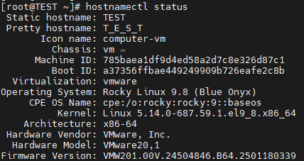

REDHAT9 버전부터 FC 952 / RFC 1123 호스트명 규격상 허용되지 않는 문자로 hostnamectl set-hostname <hostname> 으로 _ 특수문자 반영이 안됨

hostnamectl status 확인 시 systemd가 자동으로 정규화하여 static hostname과 pretty hostname이 다름

등록 방법: /etc/hostname에 직접 등록